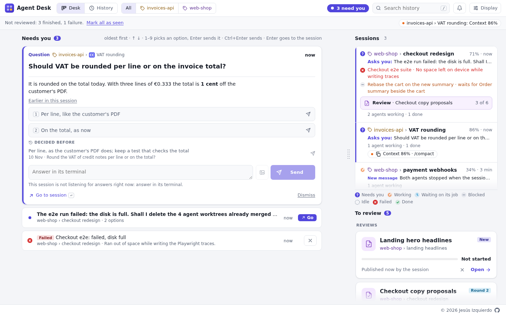

# agent-desk

**Stop watching terminals.** agent-desk tells you when an AI coding session needs you, and you answer
without going to look for it.

<p align="center">
  
</p>

You run several AI coding sessions across a few projects, each with its own swarm of sub-agents,
and step away. When you come back, one browser tab shows:

- **What happened while you were away:** back after 20 minutes or more, or at the day's first look,
  one summary of what finished, what failed, what waits and what you answered in a terminal meanwhile.
- **What needs you, in order.** Questions and permission prompts from every session, the oldest
  shown large, with the session's whole message before its options. Answer on the page (one click on
  an option, or a few words) and the session carries on by itself; or
  press "Go to session" and its exact terminal tab comes to the front.
- **What finished,** with pictures to review: before/after with a slider, zoom, and the local URL to
  see it live.
- **Pages to review at your pace:** a page a session made for you to choose from (proposals,
  variants, a checklist) opens whole on the desk, keeps your answers across devices and days, and
  goes back to the session with one click.
- **What is happening now:** each session, its agents (recorded by hooks as they launch, resume and
  stop, never by the model), what each one is doing, which are blocked and which failed, the local
  servers its commands started (found by themselves, with their link), and which sessions wrote
  something you have not read.
- **Where each branch stands:** under a session's agents, each agent's branch and worktree read from
  git (commits ahead and behind, uncommitted files, last commit, what runs in it), with how old the
  reading is; `agent-desk status` prints the same for the session, and before a compaction it is
  kept for the session to get back.
- **What was said,** so a question makes sense without scrolling back through the terminal.
- **Warnings before something breaks:** a context nearly full, a disk nearly full, worktrees piling
  up (how much each takes, which are already merged into the main branch, and the commands to remove
  them, copied, never run).
- **From your phone,** through your own Tailscale tailnet, behind a PIN.

It costs almost nothing: a short set of instructions per session; everything else is done
by deterministic hooks that never go through the model. No cloud and no telemetry: nothing leaves
your machine except an opt-in push telling a locked phone how many questions wait. It never writes
into the projects it follows (no files, no rules, no commits).

It knows nothing about any one AI tool: each tool reports through a thin adapter (`adapters/<tool>/`)
over a plain file-and-CLI protocol. Claude Code has one today; Codex, Grok or any other agent CLI
needs its own adapter, and nothing else changes.

It runs on 127.0.0.1, makes no network calls except the opt-in push to a locked phone (below), and keeps its data in `~/.cache/agent-desk/` (override
with `AGENT_DESK_HOME`). Product specification in [AGENTS.md](AGENTS.md); protocol in
[docs/protocol.md](docs/protocol.md).

## Requirements

- Linux: a session's process and terminal are found through `/proc`.
- Node.js 22.18 or later. It runs the TypeScript sources directly: no build step and no runtime
  dependencies. The commands use the `node` on `PATH` when it is recent enough, else the newest one
  installed with nvm, so a project that pins an older Node does not break the hooks.
- An AI tool with an adapter (today: Claude Code), for sessions to report to the desk.
- Optional: VS Code (for "Go to session"), tmux (for sending keys to a session), Tailscale (for the
  phone).

## Install on your computer

**1. Get it and put the two commands on your `PATH`:**

```sh
git clone https://github.com/jesusizq/agent-desk.git
cd agent-desk
ln -s "$PWD"/bin/agent-desk "$PWD"/bin/agent-desk-claude ~/.local/bin/
```

**2. Start the desk** and open http://127.0.0.1:7420:

```sh
agent-desk serve              # --port N or AGENT_DESK_PORT to change the port
```

To have it start at login and restart if it stops, use a systemd user unit,
`~/.config/systemd/user/agent-desk.service`. Paths must be absolute because systemd does not read
your shell's `PATH`; `command -v node` prints Node's.

```ini
[Unit]
Description=agent-desk

[Service]
ExecStart=/usr/bin/node /path/to/agent-desk/src/cli/main.ts serve
Restart=on-failure

[Install]
WantedBy=default.target
```

```sh
systemctl --user enable --now agent-desk
```

With Node from nvm, use
`ExecStart=/bin/bash -c 'source "$HOME/.nvm/nvm.sh" && exec node /path/to/agent-desk/src/cli/main.ts serve'`.

**3. Connect Claude Code** by installing the adapter as a plugin, from the repository folder:

```sh
claude plugin marketplace add ./adapters/claude-code
claude plugin install agent-desk@agent-desk
```

Sessions started from then on appear on the desk. To also see each session's context, plan usage and
model, wrap your status-line command (see [the adapter's README](adapters/claude-code/README.md#status-line)).

**4. Optional: "Go to session" in VS Code.** This extension brings the session's terminal to the
front:

```sh
npm run package:vscode
code --install-extension dist/agent-desk-vscode-0.1.0.vsix
```

On your own computer there is no PIN and nothing else to set up. Everything installs into your own
configuration (Claude Code plugins, VS Code extensions), never into a project.

To try the page with made-up sessions, without touching your data:

```sh
dir=$(mktemp -d) && node scripts/demo.ts "$dir" && AGENT_DESK_HOME="$dir" agent-desk serve --port 7431
```

## Decisions a session can look up

Every answer you gave is kept with its date and how the session understood it. A session, or you,
reads what its project already decided, newest first, instead of asking again:

```sh
agent-desk decisions --search "vat rounding"   # every word, any case or accent; 20 shown, --limit N
agent-desk decisions --project invoices-api    # another project, by name or by folder
```

```text
Decisions in invoices-api (/home/demo/Projects/invoices-api), newest first: 2 of 2.

2026-11-10 09:05Z · session "VAT rounding" (demo-iva)
  Asked: Round the VAT per line?
  Answer (next message in the terminal): Per line, like the PDF

2026-11-10 08:32Z · session "VAT rounding" (demo-iva)
  Asked: Number invoices with one series per year?
  Answer: Yes, one series per year
  Understood as: Format 2026-0001; the counter restarts at 1 every 1 January.
```

An answer given on the desk to that very question, or in the session's own dialog, is certain. One
taken from the next message you typed in the terminal is marked as such: you may have written about
something else. When you did, the session runs `agent-desk unanswered`: the question opens again in
Needs you, in its place, and your message stays in the conversation, not as a decision. An
interpretation (`agent-desk interpret`) goes only on an answer given in the session's current turn.

It also lists the decisions sessions reported with their results, and the ones archived after 60
days. `--json` gives the whole records; details in [docs/protocol.md](docs/protocol.md#cli).

A new question does not wait for that: when it arrives, the project's answered questions that read
like it (plain word matching, nothing leaves the machine) are printed by `agent-desk ask` and shown on
its card as **Decided before**, with date and answer. One click sends that answer again, verbatim;
nothing is answered without you. Details in [docs/protocol.md](docs/protocol.md#past-decisions).

## Reviews

A session that makes an HTML page for you to review or choose from publishes it instead of opening
it from a local server:

```sh
agent-desk review "Pay button variant" --options choice.json        # the desk draws the page from questions and options
agent-desk review "Checkout copy proposals" --page proposals.html   # the same title again: its next round
agent-desk review rv-…                                              # what you answered, read by any later session
agent-desk reviews                                                  # this project's reviews and where each stands
agent-desk review rv-… --close --reason "replaced by round 3"       # discard it: out of To review, kept in History
```

A page the session simply opens in your browser (`xdg-open proposals.html`) is published the same
way by its hooks, titled after the page, unless it is a tool's (a dependency's docs, a coverage or
test report, an app's build) or lies outside the project, its worktrees and the temporary folder.

With `--options`, the session gives only data (questions, options with a label, title, text,
screenshots and which it recommends; `agent-desk review --help` has the format) and the desk draws
the page in its own look, phone first, images zoomed with a tap. A page the session writes itself
that marks each option with `data-agent-desk-option="<label>"` (and each question with
`data-agent-desk-group="<question>"`) gets the desk's own Choose, Iterate and Discard on every option
and None of these on every question, with no code of its own. It shows in To review, never in Needs you. The page opens whole on the desk inside a sandbox with no
origin and no network: its own scripts and styles run, the images beside it are inlined when it is
published (only those inside its folder), and nothing else loads. What it keeps in `localStorage`
is kept on the desk instead, so you can go on from the phone or days later, and the next round
starts with your answers. Send hands the session a line telling it how to read them, or gives you
that line to paste into another conversation, followed word for word by your note when you write one
(drop some options, iterate one: a note alone is enough to send); your answers are also kept as a decision, so
`agent-desk decisions --search` finds them. A new session in the project is told about reviews sent
and not read yet. A review you no longer want is closed without sending it: the × on its tile, or
Close review in its bar, each asking for a second click; History keeps it, with the reason when a
session closed it with `--close`. A link you click in a review page opens in a new tab when it is a
local preview (`localhost`), so a session can offer live prototypes that screenshots cannot show (an
option's `url` in `--options` becomes "Open live ↗"); on the phone it says it runs on the computer,
and a link to anywhere else is not opened. Details in [docs/protocol.md](docs/protocol.md#reviews).

## Send keys to a session (tmux)

Sessions that run inside tmux get a **Terminal** section in their window, under **More**. Its buttons
send `/compact`, Escape, Enter and 1–5 to the session's terminal, which answers the dialogs that only
the terminal can answer. Each button asks for a second click before it sends anything.

To make every VS Code terminal a tmux session that ends when its tab closes, add to VS Code's user
settings:

```json
"terminal.integrated.profiles.linux": {
  "tmux": { "path": "tmux", "args": ["new-session", ";", "set-option", "destroy-unattached", "on", ";", "set-option", "mouse", "on"] }
},
"terminal.integrated.defaultProfile.linux": "tmux"
```

Sessions opened in those terminals from then on can receive keys.

## From your phone (Tailscale)

The desk stays on 127.0.0.1. Tailscale Serve publishes it on your tailnet only, never on the
internet, and the desk lets in only your Tailscale login, after a PIN.

Tailscale Serve is the only way in from another device. Never use Tailscale Funnel, a port forward
(SSH, router), a WSL portproxy, socat, a reverse proxy, or bind the desk to 0.0.0.0: each makes a
request from elsewhere look like one from this computer, which needs no PIN and gets the secret that
sends keys to sessions and ends them. The desk refuses a request that carries a proxy's headers
(`Tailscale-*`, `X-Forwarded-*`, `Forwarded`, `Via`, `X-Real-IP`) or comes from an address other
than loopback, unless it is the configured Tailscale host and login; a plain TCP forward running on
this computer adds neither, so the desk cannot tell it apart.

1. Install Tailscale on the computer and the phone, signed in to the same account. In the admin
   console, under DNS, enable **HTTPS Certificates**.
2. Publish the desk on the tailnet. It needs root, or `sudo tailscale set --operator=$USER` once.

   ```sh
   sudo tailscale serve --bg --https=8443 http://127.0.0.1:7420
   ```

3. Tell the desk which host and login to accept: add both lines to the unit's `[Service]` section,
   then `systemctl --user daemon-reload && systemctl --user restart agent-desk`.

   ```ini
   Environment=AGENT_DESK_REMOTE_HOST=<machine>.<tailnet>.ts.net:8443
   Environment=AGENT_DESK_REMOTE_USER=<your Tailscale login, e.g. alice@github>
   ```

4. Set the PIN, at least 6 digits, on the computer:

   ```sh
   agent-desk pin
   ```

5. On the phone, open `https://<machine>.<tailnet>.ts.net:8443` and enter the PIN. The unlock lasts
   24 hours on that device. After five wrong PINs, the desk refuses every attempt for 15 minutes.

While the unlock lasts, the phone keeps the last desk it saw and shows it, read only, when the
computer does not answer. When the unlock ends the phone deletes that copy, even if it is offline
then: a lost phone holds the desk for 24 hours at most. The computer itself keeps its copy.

From the phone you can answer questions, allow or deny permission prompts, and send keys to tmux
sessions. "Go to session" is hidden, and local previews (`localhost` URLs) are named, not linked,
because they run on the computer.

### Notifications on a locked phone

A locked phone runs no page, so only Web Push reaches it, and that always goes through the push
service of the phone's browser, outside the tailnet.

- **iPhone:** in Safari, Share → Add to Home Screen, then open the desk from that icon.
- **Android:** open the desk in Chrome or Firefox. Not yet tried on a real Android phone.

Then turn on "Notifications" in the bell menu. When a question or permission prompt opens, the desk
sends the push service a notification saying only how many wait ("2 need you"), encrypted for the
phone (RFC 8291) and signed with this install's key (`push.json` in the store). It is the desk's only
outbound call, and only to `*.push.apple.com`, `fcm.googleapis.com` or
`updates.push.services.mozilla.com`.
Each notification replaces the previous one, so the lock screen holds one with the latest count.

A device gets notifications only while its PIN is in. When its 24 hours end it is told once, they
stop, and they start again when the PIN is entered. Tapping a notification opens "Needs you", and the app's icon shows how
many questions were open at the last notification, corrected when the app is open.

### The terminal itself, from the phone (Termius)

For anything the desk cannot do, open the session's terminal from an SSH app such as Termius.

1. On the computer, turn on Tailscale SSH with `sudo tailscale set --ssh`. The default tailnet
   policy allows it from your own devices and asks you to sign in to Tailscale again from time to
   time.
2. In Termius, add a host: the address is `<machine>.<tailnet>.ts.net` and the username is your user
   on the computer. Leave the password and key empty: Tailscale authenticates the connection.
3. On the phone, the session's window shows the command that opens its terminal, under **More**, then
   **Terminal** (for example `tmux attach -t %7`). Run it in Termius; detach with `Ctrl-b d`. The
   terminal takes the size of the screen used last, so it shrinks to the phone's width while you
   use it there.

## Develop

```sh
npm ci          # type-checking tools only
npm run check   # strict type checks: Node code, the page (JSDoc), the VS Code extension
npm test        # node --test: store, server, CLI, Claude Code adapter, the page in headless Chrome, its looks
```

The page tests drive Chrome through its DevTools protocol, with no test dependency. They use
`google-chrome` or `chromium` from `PATH`, or the browser in `AGENT_DESK_CHROME`; without one they
are skipped, except in CI, where they fail.

`test/visual.test.ts` compares the key screens, desktop light and dark and phone, with the PNGs in
`test/visual/<platform>/`. A screen fails when more than 16 pixels
differ by more than 8 of 255 in a channel: a box moved by 1 px or a colour nudged by 4% fails. The
failure prints the capture and a copy with the changed pixels in magenta, both under
`$TMPDIR/agent-desk-visual/`. When a change is intended, look at those, then accept it:

```sh
npm run visual:update   # draws the baselines again; commit the PNGs that changed
```

Text is drawn with the machine's fonts, so the baselines hold only on a machine with the fonts in
`test/visual/<platform>/renderer.json`: elsewhere, and in CI, the test is skipped and says why. A
Chrome update can shift anti-aliasing; the failure then names both versions.

`git config core.hooksPath .githooks` turns on the repository's hooks, once per clone: `pre-commit`
runs `npm run check`, `pre-push` runs `npm run check` and `npm test`. Commits and pushes that touch
only Markdown or `docs/` skip them.

The server moves what is older than 60 days (closed questions, results with their images, finished
sessions) to `archive/` in the store, at start and every 6 hours.

## Acknowledgements

agent-desk started from ideas in [Kanvas](https://github.com/XMihura/Kanvas), a task board shared
between a developer and their agents.

## License

MIT, see [LICENSE](LICENSE).
