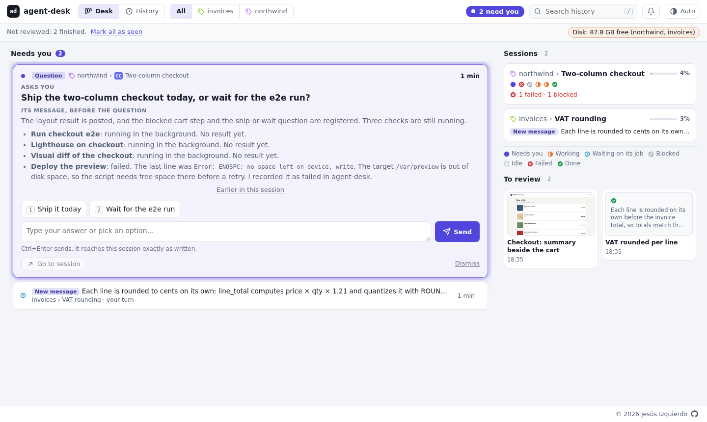

# agent-desk

**Stop watching terminals.** agent-desk tells you when an AI coding session needs you, and you answer
without going to look for it.

<p align="center">
  
</p>

You run several AI coding sessions across a few projects, each with its own swarm of sub-agents,
and step away. When you come back, one browser tab shows:

- **What needs you, in order.** Questions and permission prompts from every session, the oldest
  shown large. Answer on the page (a click or a few words) and the session carries on by itself; or
  press "Go to session" and its exact terminal tab comes to the front.
- **What finished,** with pictures to review: before/after with a slider, zoom, and the local URL to
  see it live.
- **What is happening now:** each session, its agents, what each one is doing, which are blocked and
  which failed, and which sessions wrote something you have not read.
- **What was said,** so a question makes sense without scrolling back through the terminal.
- **Warnings before something breaks:** a context nearly full, a disk nearly full, worktrees piling
  up (how much each takes, which are already merged into the main branch, and the commands to remove
  them, copied, never run).
- **From your phone,** through your own Tailscale tailnet, behind a PIN.

It costs almost nothing: about 400 tokens per session for its instructions; everything else is done
by deterministic hooks that never go through the model. Nothing leaves your machine, and it never
writes into the projects it follows (no files, no rules, no commits).

It knows nothing about any one AI tool: each tool reports through a thin adapter (`adapters/<tool>/`)
over a plain file-and-CLI protocol. Claude Code has one today; Codex, Grok or any other agent CLI
needs its own adapter, and nothing else changes.

It runs on 127.0.0.1, makes no network calls, and keeps its data in `~/.cache/agent-desk/` (override
with `AGENT_DESK_HOME`). Product specification in [AGENTS.md](AGENTS.md); protocol in
[docs/protocol.md](docs/protocol.md).

## Requirements

- Linux: a session's process and terminal are found through `/proc`.
- Node.js 22.18 or later. It runs the TypeScript sources directly: no build step and no runtime
  dependencies.
- An AI tool with an adapter (today: Claude Code), for sessions to report to the desk.
- Optional: VS Code (for "Go to session"), tmux (for sending keys to a session), Tailscale (for the
  phone).

## Install on your computer

**1. Get it and put the two commands on your `PATH`:**

```sh
git clone https://github.com/jesusizq/agent-desk.git
cd agent-desk
ln -s "$PWD"/bin/agent-desk "$PWD"/bin/agent-desk-claude ~/.local/bin/
```

**2. Start the desk** and open http://127.0.0.1:7420:

```sh
agent-desk serve              # --port N or AGENT_DESK_PORT to change the port
```

To have it start at login and restart if it stops, use a systemd user unit,
`~/.config/systemd/user/agent-desk.service`. Paths must be absolute because systemd does not read
your shell's `PATH`; `command -v node` prints Node's.

```ini
[Unit]
Description=agent-desk

[Service]
ExecStart=/usr/bin/node /path/to/agent-desk/src/cli/main.ts serve
Restart=on-failure

[Install]
WantedBy=default.target
```

```sh
systemctl --user enable --now agent-desk
```

With Node from nvm, use
`ExecStart=/bin/bash -c 'source "$HOME/.nvm/nvm.sh" && exec node /path/to/agent-desk/src/cli/main.ts serve'`.

**3. Connect Claude Code** by installing the adapter as a plugin, from the repository folder:

```sh
claude plugin marketplace add ./adapters/claude-code
claude plugin install agent-desk@agent-desk
```

Sessions started from then on appear on the desk. To also see each session's context, plan usage and
model, wrap your status-line command (see [the adapter's README](adapters/claude-code/README.md#status-line)).

**4. Optional: "Go to session" in VS Code.** This extension brings the session's terminal to the
front:

```sh
npm run package:vscode
code --install-extension dist/agent-desk-vscode-0.1.0.vsix
```

On your own computer there is no PIN and nothing else to set up. Everything installs into your own
configuration (Claude Code plugins, VS Code extensions), never into a project.

To try the page with made-up sessions, without touching your data:

```sh
dir=$(mktemp -d) && node scripts/demo.ts "$dir" && AGENT_DESK_HOME="$dir" agent-desk serve --port 7431
```

## Send keys to a session (tmux)

Sessions that run inside tmux get a **Terminal** section in their window, under **More**. Its buttons
send `/compact`, Escape, Enter and 1–5 to the session's terminal, which answers the dialogs that only
the terminal can answer. Each button asks for a second click before it sends anything.

To make every VS Code terminal a tmux session that ends when its tab closes, add to VS Code's user
settings:

```json
"terminal.integrated.profiles.linux": {
  "tmux": { "path": "tmux", "args": ["new-session", ";", "set-option", "destroy-unattached", "on", ";", "set-option", "mouse", "on"] }
},
"terminal.integrated.defaultProfile.linux": "tmux"
```

Sessions opened in those terminals from then on can receive keys.

## From your phone (Tailscale)

The desk stays on 127.0.0.1. Tailscale Serve publishes it on your tailnet only, never on the
internet, and the desk lets in only your Tailscale login, after a PIN.

1. Install Tailscale on the computer and the phone, signed in to the same account. In the admin
   console, under DNS, enable **HTTPS Certificates**.
2. Publish the desk on the tailnet. It needs root, or `sudo tailscale set --operator=$USER` once.

   ```sh
   sudo tailscale serve --bg --https=8443 http://127.0.0.1:7420
   ```

3. Tell the desk which host and login to accept: add both lines to the unit's `[Service]` section,
   then `systemctl --user daemon-reload && systemctl --user restart agent-desk`.

   ```ini
   Environment=AGENT_DESK_REMOTE_HOST=<machine>.<tailnet>.ts.net:8443
   Environment=AGENT_DESK_REMOTE_USER=<your Tailscale login, e.g. alice@github>
   ```

4. Set the PIN, at least 6 digits, on the computer:

   ```sh
   agent-desk pin
   ```

5. On the phone, open `https://<machine>.<tailnet>.ts.net:8443` and enter the PIN. The unlock lasts
   12 hours on that device. After five wrong PINs, the desk refuses every attempt for 15 minutes.

From the phone you can answer questions, allow or deny permission prompts, and send keys to tmux
sessions. "Go to session" is hidden, and local previews (`localhost` URLs) are named, not linked,
because they run on the computer.

### The terminal itself, from the phone (Termius)

For anything the desk cannot do, open the session's terminal from an SSH app such as Termius.

1. On the computer, turn on Tailscale SSH with `sudo tailscale set --ssh`. The default tailnet
   policy allows it from your own devices and asks you to sign in to Tailscale again from time to
   time.
2. In Termius, add a host: the address is `<machine>.<tailnet>.ts.net` and the username is your user
   on the computer. Leave the password and key empty: Tailscale authenticates the connection.
3. On the phone, the session's window shows the command that opens its terminal, under **More**, then
   **Terminal** (for example `tmux attach -t %7`). Run it in Termius; detach with `Ctrl-b d`. The
   terminal takes the size of the screen used last, so it shrinks to the phone's width while you
   use it there.

## Develop

```sh
npm ci          # type-checking tools only
npm run check   # strict type checks: Node code, the page (JSDoc), the VS Code extension
npm test        # node --test: store, server, CLI, Claude Code adapter
```

The server moves what is older than 60 days (closed questions, results with their images, finished
sessions) to `archive/` in the store, at start and every 6 hours.

## Acknowledgements

agent-desk started from ideas in [Kanvas](https://github.com/XMihura/Kanvas), a task board shared
between a developer and their agents.

## License

MIT, see [LICENSE](LICENSE).
